# ConceptFlow AI

**Any mathematical idea, animated and narrated in the manner of 3Blue1Brown - made by a studio of AI agents.**

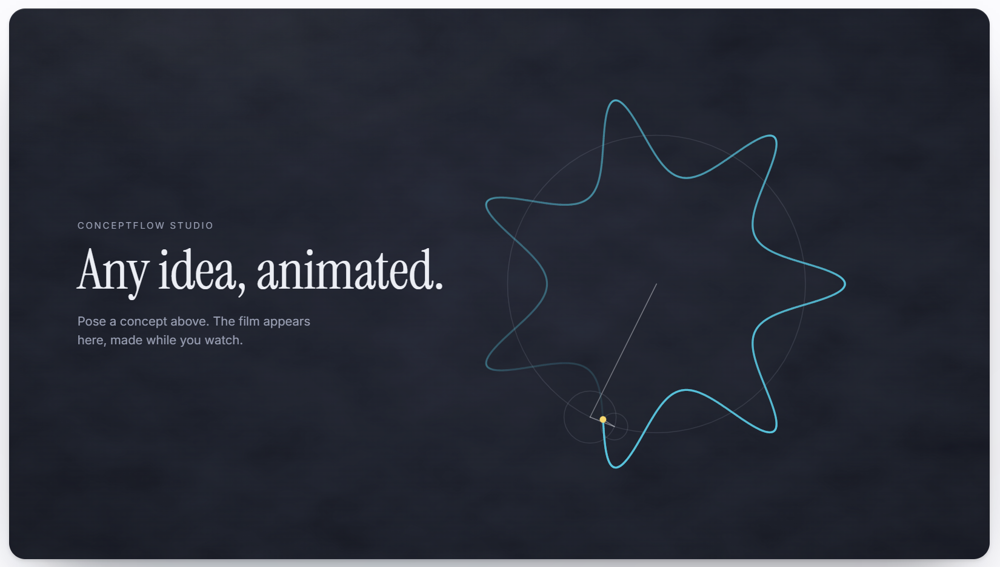
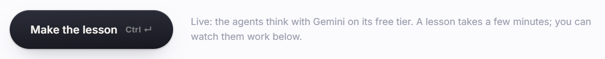
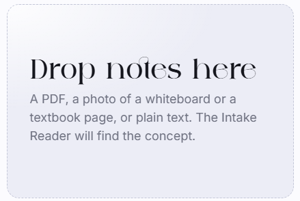
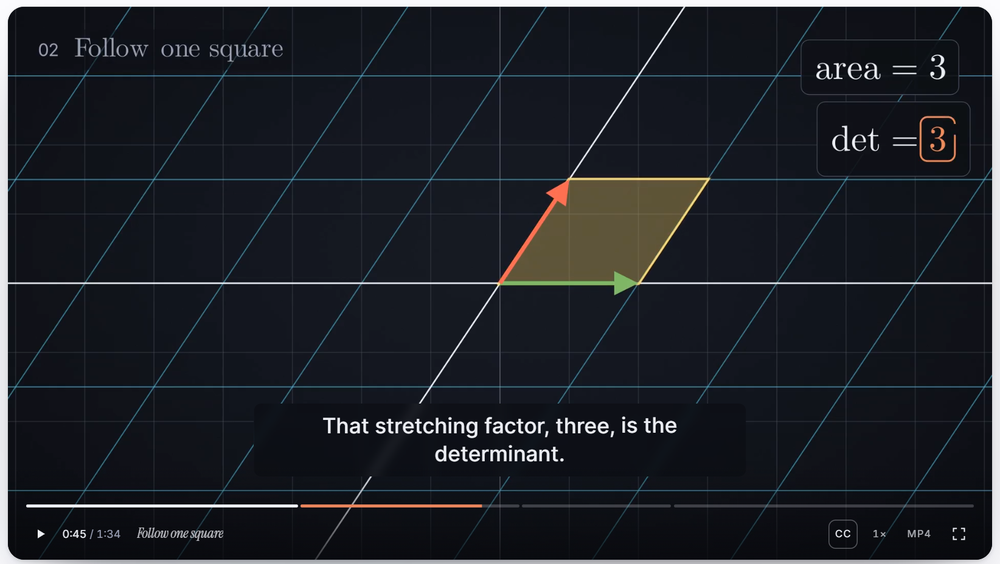
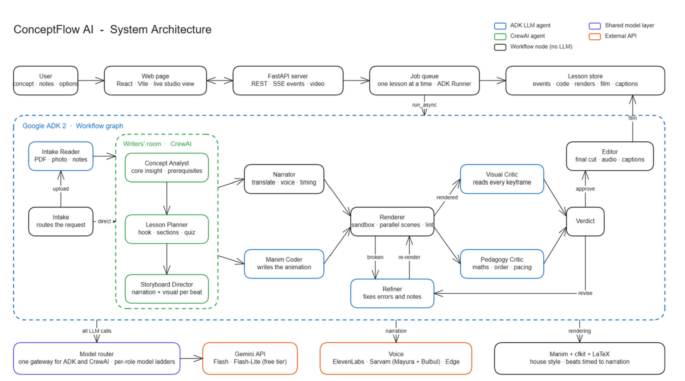


Type a concept (or drop in lecture notes, a research paper, a photo of a whiteboard). A Google ADK workflow parses the
upload and grounds the concept with MCP tools, then hands the lesson design over the **A2A protocol** to a CrewAI
*writers' room*, which analyses it, plans a lesson and storyboards it shot by shot. Back in the workflow a narrator
voices every line while a Manim coder animates it; the scenes render in parallel; a vision critic and a mathematics
critic (backed by a SymPy formula check) review a keyframe of every beat; a refiner fixes whatever they flag; and an
editor cuts the film with word-timed captions, chapters, a quiz - and a structured report of how it was all made.

Every step is guarded (input, document, tool, agent, code and output guardrails), monitored through callbacks, traced
end to end with OpenTelemetry (Langfuse-ready) and recorded with provenance. **[How each minimum requirement is met →](docs/REQUIREMENTS.md)**
· **[End-to-end evaluation →](docs/evaluation.md)**

Group 21 · Agentic AI project · Sai Sharath Chandra Koppu, Rahul Kumar, Prashant

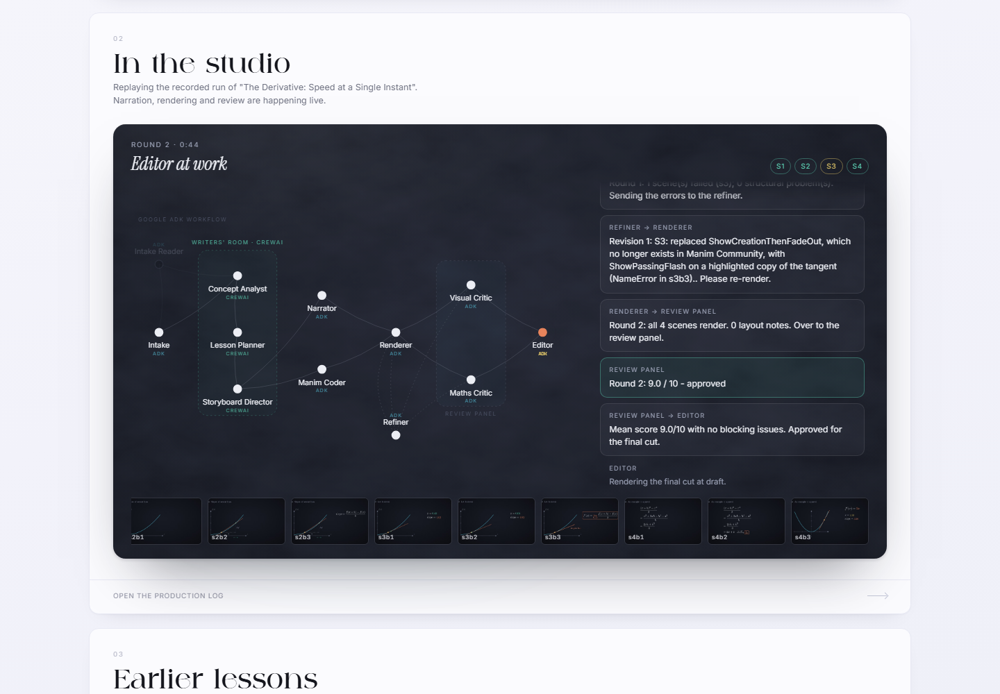

---

## Quick start (Windows)

Needs Python 3.11-3.13, Node 20+, and a LaTeX distribution (MiKTeX or TeX Live - Manim typesets maths with it).

```powershell
.\run.ps1 -Setup      # .venv, Python + npm dependencies, creates .env
.\run.ps1             # builds the page once, then serves everything on http://127.0.0.1:8010
.\run.ps1 -Dev        # or: API on :8010 + hot-reloading page on :5179
```

macOS / Linux: `./run.sh setup`, then `./run.sh` or `./run.sh dev`. Docker: see [Deployment](#deployment).

**No keys yet?** It still works. Without `GOOGLE_API_KEY` the studio runs in **replay mode**: the agents replay the
recorded replies of a real run (two showcases: *The Derivative* and *The Determinant*), while everything else -
the CrewAI crew, the ADK workflow, narration, rendering, the correction loop, review routing, assembly - runs for real.

## API keys (`.env`)

All keys are optional and every service used has a free tier. Put them in `.env` (created from `.env.example`):

| Key | What it powers | Free tier | Get it |
|---|---|---|---|
| `GOOGLE_API_KEY` | Every agent's reasoning (Gemini), in both frameworks | Flash ≈ 20 req/day/model, Flash-Lite ≈ 500 | [aistudio.google.com/apikey](https://aistudio.google.com/apikey) |
| `ELEVENLABS_API_KEY` | Premium English narration with character timestamps | ≈ 10k credits/month (≈ 10 min) | [elevenlabs.io → API keys](https://elevenlabs.io/app/settings/api-keys) |
| `SARVAM_API_KEY` | Indian languages: Mayura translation + Bulbul voices | Sign-up credits | [dashboard.sarvam.ai](https://dashboard.sarvam.ai) |
| `LANGFUSE_PUBLIC_KEY` / `LANGFUSE_SECRET_KEY` | Every lesson's trace in Langfuse (OpenTelemetry) | Hobby plan, 50k units/month | [cloud.langfuse.com](https://cloud.langfuse.com) → project → Settings → API Keys |

Without ElevenLabs/Sarvam keys, narration falls back to Microsoft Edge's free neural voices (no key), or captions only.

**Free-tier budget.** A lesson costs about **7-9 model calls**: 3 for the writers' room (Flash-Lite), 1 for the coder,
2 per review round and 1 per correction ([measured](docs/evaluation.md)). Because Gemini's free quota is *per model per day*, each role has a
**ladder** of models (`MODELS_*` in `.env`) and a shared router moves down it when a model's quota runs out, parking
that model until the quota resets at midnight Pacific. Spreading roles over different models multiplies the free
quota - enough for well over ten lessons a day.

## How it works

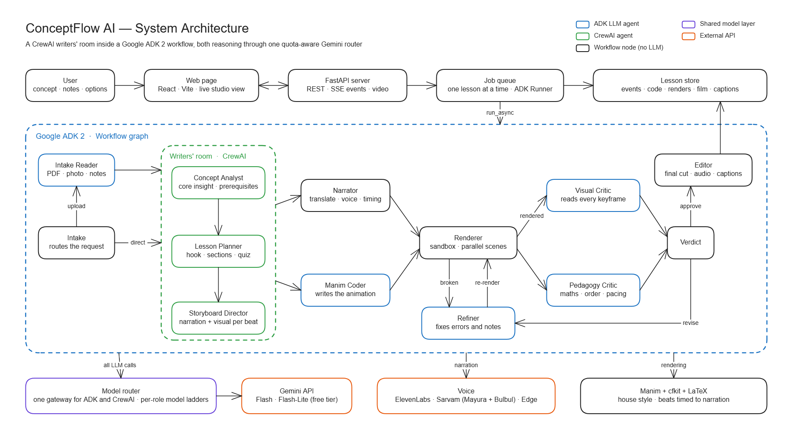

Editable source: [`docs/architecture.excalidraw`](docs/architecture.excalidraw) (open it at excalidraw.com or in the VS Code Excalidraw extension; `docs/architecture.svg` is a vector export).

The whole graph is a **Google ADK 2 `Workflow`** ([`agents/workflow.py`](backend/conceptflow/agents/workflow.py)):
fan-out/join nodes run narration and coding in parallel (and both critics in parallel), conditional routes carry the
correction cycle `render → critics → verdict → refiner → render`, bounded by `MAX_REVISIONS`. The ADK app carries two
plugins that see every agent, model and tool call: `MonitoringPlugin` and `GuardrailPlugin`
([`monitoring.py`](backend/conceptflow/monitoring.py)).

### Why two frameworks, and who does what

| | CrewAI | Google ADK |
|---|---|---|
| Role | The **writers' room**: collaborative, role-played reasoning where each specialist's view shapes the next | The **studio floor**: orchestration, parallelism, conditional routing, the correction cycle, callbacks, session state |
| Agents | Concept Analyst → Lesson Planner → Storyboard Director (sequential crew, each task receives the previous task's structured output as context) | Intake Reader, Manim Coder, Visual Critic, Maths & Pedagogy Critic, Refiner (`LlmAgent`s) + Intake, Narrator, Renderer, Verdict, Editor (workflow nodes) |
| How they meet | Over the **A2A protocol**: the crew is published as an A2A agent with an Agent Card ([`writers_room_a2a.py`](backend/conceptflow/agents/writers_room_a2a.py)); the ADK node `writers_room` is its client ([`a2a_client.py`](backend/conceptflow/agents/a2a_client.py)), streams its progress to the page and writes the validated `LessonDesign` into session state | |

**One brain for both.** Both frameworks call Gemini through a single quota-aware
[`ModelRouter`](backend/conceptflow/llm/router.py): ADK agents via a custom `BaseLlm`
([`RoutedGemini`](backend/conceptflow/llm/adk_model.py), which delegates to ADK's own `Gemini` class), CrewAI agents
via a custom `BaseLLM` ([`RoutedCrewLLM`](backend/conceptflow/llm/crew_llm.py), which passes CrewAI's
`output_pydantic` schema to Gemini as structured output). A model parked by one framework is skipped by the other.

**How agents communicate.** Every hand-off is a typed artifact ([`schemas.py`](backend/conceptflow/schemas.py)) -
`ConceptAnalysis → LessonPlan → Storyboard → code → VisualReview + PedagogyReview` - used simultaneously as Gemini
response schemas, CrewAI `output_pydantic` types and ADK `output_schema` types. Each hand-off is also published as a
message from one agent to the next; the page streams them live (Server-Sent Events) and animates them along the
agent graph. The whole record is kept per lesson in `data/lessons/<id>/events.jsonl` and shown in the production log.

### Tools over MCP

The studio's tools live in one MCP server ([`tools/server.py`](backend/conceptflow/tools/server.py)), mounted at
`/mcp/` (Streamable HTTP) and usable by any MCP client:

| Tool | What it does | Who calls it |
|---|---|---|
| `read_document` | parses an upload (pypdf): title, abstract, sections, key terms, text | intake (every upload) and the upload preview |
| `lookup_concept` | Wikipedia summary of the concept, title-matched | grounding before the crew; the CrewAI analyst (live) |
| `check_math` | SymPy: verify identities, simplify, differentiate, solve | the Formula Check node; the ADK maths critic and the CrewAI analyst (live) |
| `search_lessons` | full-text search of the lesson library (SQLite FTS5) | intake |

Workflow steps call them through an MCP client session, ADK agents through `McpToolset`, CrewAI agents through
`mcps=[MCPServerHTTP(...)]`. Every result is type-checked against its Pydantic model before anyone uses it.

### Guardrails, monitoring, tracing

- **Guardrails** ([`guardrails.py`](backend/conceptflow/guardrails.py)): prompt injection, abuse and harmful requests
  are refused at the API; personal data is redacted; instruction-like lines in uploads are removed; tool arguments and
  tool results are validated by an ADK plugin; CrewAI task guardrails make agents redo invalid output; generated code
  is sandboxed; narration is screened before it is voiced.
- **Monitoring**: ADK plugin callbacks, CrewAI event listeners and the model router write one structured log per
  lesson (`monitor.jsonl`) with every agent step, model call (tokens, latency), tool call and error.
- **Tracing and provenance** ([`observability.py`](backend/conceptflow/observability.py)): one OpenTelemetry trace per
  lesson across both frameworks (the trace context rides inside A2A messages), exported to `trace.jsonl` and to
  Langfuse when its keys are set; `provenance.jsonl` links every artifact to the hashes of what it was made from.
- **Structured report** ([`report.py`](backend/conceptflow/report.py)): a validated `FinalReport` per lesson, as JSON
  and as Markdown tables.

### Making every video look good

The coder does not write bare Manim. Every scene subclasses `ConceptScene` from **cfkit**
([`backend/cfkit`](backend/cfkit)), the studio's house style:

- **Narration-timed beats** - `with self.beat("s2b1") as b:` makes each block last exactly as long as its line of
  narration (recorded in parallel, read from `timing.json`); run times are shares of the line (`b.t(0.4)`).
- **One look** - a dark vignette stage, the 3Blue1Brown palette plus one terracotta accent, CMU Serif text that
  matches the LaTeX maths, pre-styled axes/grids/labels/cards, crisp zooms (a fix for a Manim Cairo bug that fattened
  lines when the camera zoomed).
- **Review notes while rendering** - a keyframe at the end of every beat and a layout report (text off-frame,
  overlapping, too small, in the caption zone, crowded, blank stage, beats overrunning their narration). The renderer
  turns the keyframes into contact sheets for the vision critic.
- **Safety** - generated code is parsed and rejected if it imports anything beyond Manim/cfkit/maths, touches files or
  processes, or reaches for dunder attributes; each scene renders in its own process with a timeout.
- **Always a complete film** - scenes render in parallel and are cached by content, so a correction re-renders only
  what changed; a scene that still fails after the last round is replaced by a clean fallback built from the storyboard.

### Voice and languages

- **ElevenLabs** (English) returns character-level timestamps → word-exact captions that brighten as they are spoken.
- **Sarvam AI** handles Hindi, Telugu, Tamil, Kannada, Malayalam, Bengali, Marathi, Gujarati, Odia and Punjabi:
  **Mayura** translates the narration (in `code-mixed` mode it keeps technical terms in English, the way Indian
  classrooms speak) and **Bulbul** voices it. On-screen maths stays universal.
- **Edge** neural voices (free, no key) are the fallback; **captions only** is always available.

## The page

One page in the Keystone design language - lavender paper, near-black ink, one terracotta accent, the *Against*
display face, numbered panels:

1. **Pose a concept** - a prompt (or dropped notes), audience, length, narration language, voice, resolution. A dropped
   file is parsed at once by the MCP document tool and screened, so you see the title, pages and sections the agents
   will read.
2. **The lesson** - while it is made: the agents as a live graph (CrewAI group inside the ADK workflow, the model
   serving each agent, hand-off pulses, the A2A exchange, the MCP tools lighting up as they are called), their
   conversation, and frames as they render. When done: the film with a
   chapter-segmented scrubber, word-timed captions, speed, download, and a quiz at the end.
3. **Earlier lessons** - everything made so far.

*Open the production log* shows how a lesson was made: the conversation, the storyboard beside the frame that realised
each beat, the review panel's scores, notes and formula checks, the final Manim code, the plan - and **Performance**
(time per agent, model and tool calls, guardrail checks, cost), the **Trace** (a span waterfall across ADK, A2A, CrewAI
and MCP) and **Provenance**. The structured report downloads as Markdown or JSON.

| The page | The finished lesson |
|---|---|
| 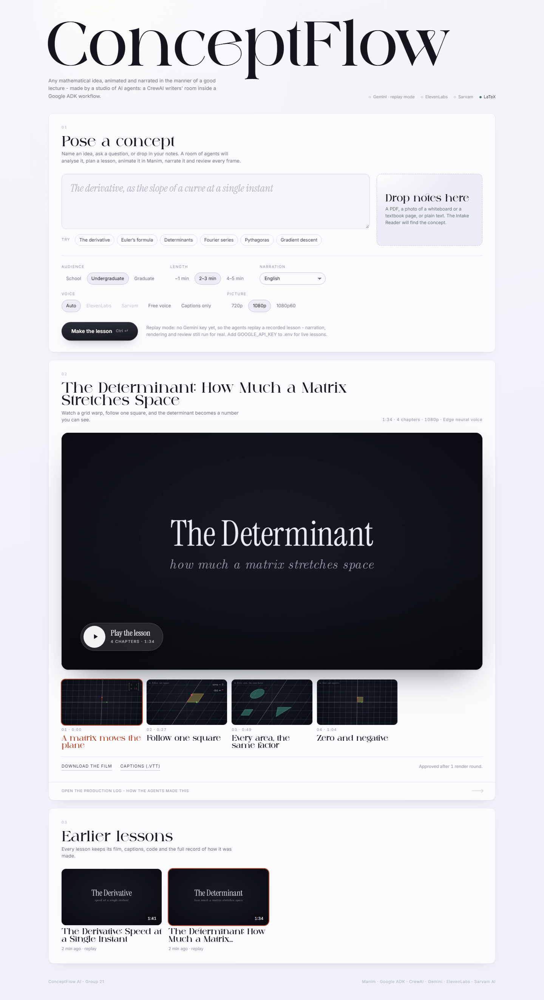 | 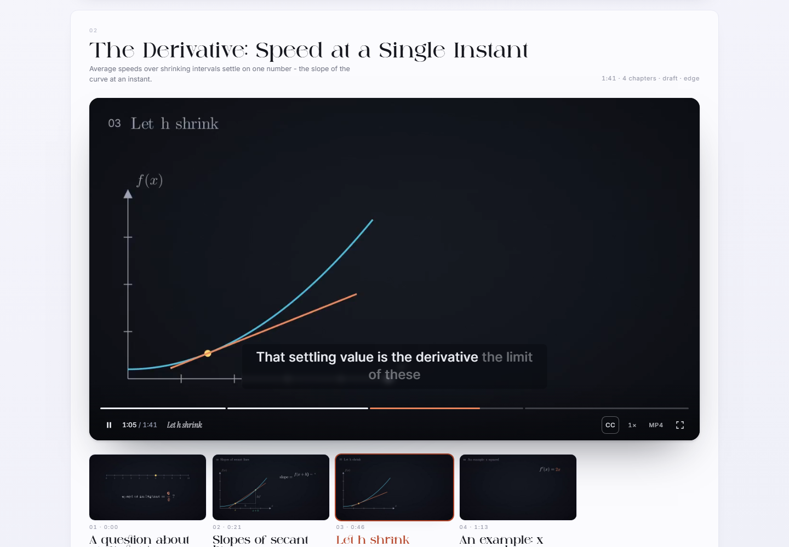 |
| **Production log: storyboard** | **Production log: review** |
| 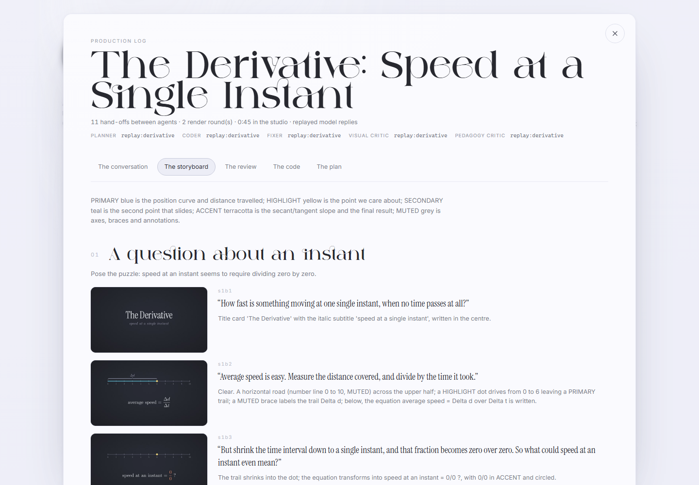 | 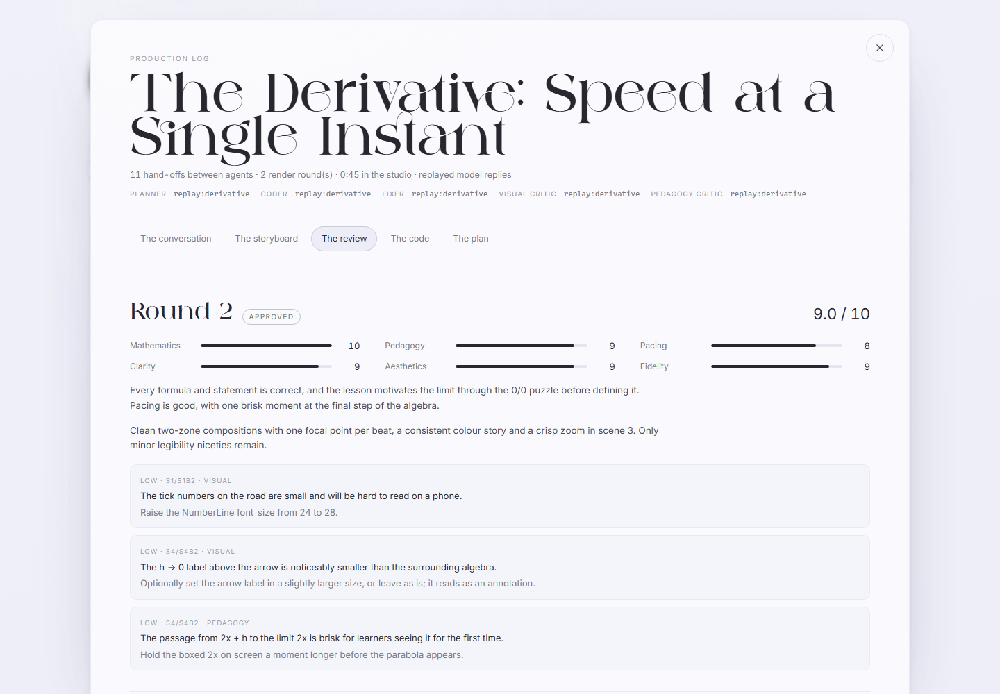 |

What the visual critic sees - one keyframe per beat:

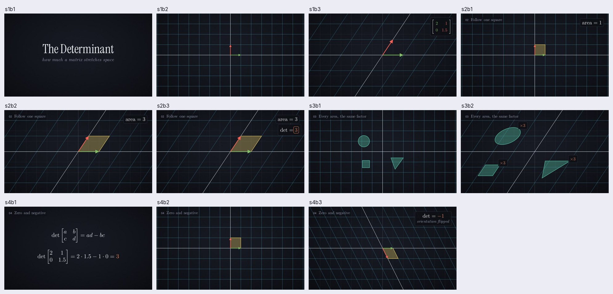

## Project layout

```
backend/
  cfkit/                 Manim house style: ConceptScene, beats, components, theme, render runner
  conceptflow/
    agents/              ADK workflow, CrewAI writers' room (+ its A2A server), A2A client node, production nodes
    tools/               MCP server, tool implementations, typed results, result validation, lesson library
    guardrails.py        input/document/output guardrails and CrewAI task guardrails
    monitoring.py        ADK monitoring + guardrail plugins, CrewAI listeners, per-lesson log
    observability.py     OpenTelemetry tracing (Langfuse/OTLP export) and provenance
    metrics.py, report.py   per-lesson metrics and the structured FinalReport
    llm/                 model router, ADK + CrewAI adapters, replay
    voice/               ElevenLabs, Sarvam, Edge, narrator, audio utilities
    render/              sandbox, parallel renderer, contact sheets, assembly
    prompts/             coder, refiner, critics, reader prompts
    showcase/            recorded runs for replay mode
    server.py, jobs.py   FastAPI + job queue + event stream
  tests/                 pytest (add --slow for the end-to-end replay test)
frontend/                Vite + React + TypeScript, plain CSS on design tokens
scripts/                 evaluate.py (end-to-end evaluation), render_lesson.py, smoke_replay.py, build_showcase.py
deploy/                  Cloud Run and Hugging Face Spaces guides
assets/fonts/            CMU Serif, Instrument Serif, Inter (OFL) and Against (personal-use licence)
data/                    lessons, renders, caches (created at runtime, git-ignored)
```

## Useful commands

```powershell
.\.venv\Scripts\python.exe -m pytest backend\tests -q            # fast tests
.\.venv\Scripts\python.exe -m pytest backend\tests -q --slow     # + the whole studio end to end (~90 s)
.\.venv\Scripts\python.exe scripts\evaluate.py                     # end-to-end evaluation -> docs\evaluation.md
.\.venv\Scripts\python.exe scripts\smoke_replay.py "the derivative" --quality preview
.\.venv\Scripts\python.exe scripts\render_lesson.py backend\conceptflow\showcase\determinant --quality hd
```

## Deployment

```bash
docker build -t conceptflow .
docker run -p 8010:8010 --env-file .env -v conceptflow-data:/app/data conceptflow
```

The image carries TeX Live, Cairo/Pango and the built page, and listens on `$PORT`; lessons persist in the
`conceptflow-data` volume. Step-by-step cloud guides: **[Hugging Face Spaces](deploy/huggingface-spaces.md)** (free, no
card) and **[Google Cloud Run](deploy/cloud-run.md)**.

## Notes

- **Fonts.** CMU Serif, Instrument Serif and Inter are SIL OFL. The page's wordmark face, *Against*, is a
  personal-use demo licence (`frontend/public/fonts/AGAINST-LICENSE.txt`): fine for a college project, but switch
  `--display` in `frontend/src/styles/tokens.css` to `'Instrument Serif'` before deploying publicly.
- **MiKTeX** may ask to install a LaTeX package the first time a new command is used; allow it (or enable automatic
  package installation in the MiKTeX console).
- **Ports.** The studio uses 8010 (API) and 5179 (dev page) so it can run beside other projects on 8000/5173.
